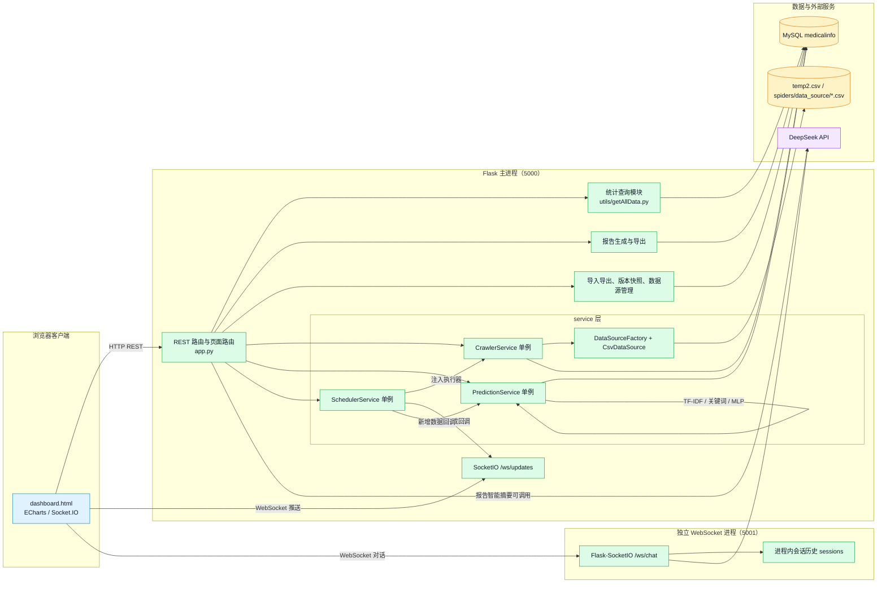

# 系统架构图

该图依据实际进程、端口、模块依赖和数据流核实。

## 部署说明

- 主站可通过 5000 端口提供看板和全部 REST API。
- AI 聊天由独立的 5001 进程提供。
- 定时采集由 `SchedulerService` 内置的 `BackgroundScheduler` 执行，默认每 30 分钟触一次；周期可通过 `CRAWL_INTERVAL_MINUTES` 配置。
- MySQL 配置统一由 `utils/db_config.py` 从 `.env` 读取。
