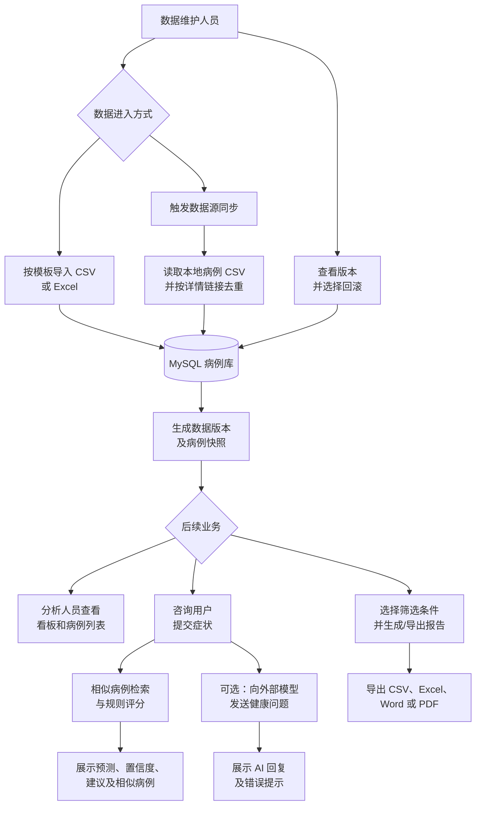

# 医疗疾病数据分析与可视化系统需求规格说明书

| 项目 | 内容 |
|---|---|
| 文档版本 | 1.0 |
| 编写日期 | 2026-11-17 |
| 文档状态 | 基于现有代码的需求基线（草案） |
| 系统名称 | 医疗疾病数据分析与可视化系统 |
| 依据 | 用户任务描述、项目说明及当前仓库中的应用代码、页面、数据库结构和配置 |

> **阅读说明**：本文区分“现有实现”与“目标要求/待完善项”。需求描述系统应提供的业务能力；文中明确列出的差距不得视为已经上线。非功能指标是建议验收目标，不代表已完成性能或安全测试。

## 1. 文档目的与范围基线

本文为系统当前版本建立可追溯的功能与质量需求，供需求评审、开发、测试和后续验收使用。梳理范围包括 Flask 应用与接口、独立数据看板、WebSocket 对话服务、病例统计/预测/数据源模块、数据库表结构、依赖和项目说明。

### 1.1 系统范围

系统围绕医疗病例数据提供以下业务能力：

1. 展示病例总量、疾病类型、性别、科室、年龄和身高体重等统计结果。
2. 查询病例列表，并按关键词检索、分页浏览。
3. 根据症状描述生成疾病预测、置信度、建议及相似病例。
4. 管理病例数据导入导出、数据源运行状态、数据版本与版本回滚。
5. 配置报告模板、按条件生成统计报告并导出。
6. 调用外部大语言模型生成报告说明或医疗健康问答。

系统定位为**病例数据分析和辅助信息工具**，不替代医生诊断、处方、临床决策、电子病历系统或急救服务。

### 1.2 现状与证据边界

- 主要运行入口是 [app.py](../app.py)，病例字段定义见 [medicalinfo.sql](../medicalinfo.sql)，统计逻辑见 [utils/getAllData.py](../utils/getAllData.py)，预测逻辑见 [machine/tree.py](../machine/tree.py)，本地 CSV 数据源处理见 [spiders/crawler_scheduler.py](../spiders/crawler_scheduler.py)，对话服务见 [websocket_chat.py](../websocket_chat.py)。
- [dashboard.html](../dashboard.html) 提供独立数据看板、预测输入、单连接 AI 对话、病例关键词搜索和每页 10 条的分页显示。
- 前端模板目录当前只有依赖清单及脚手架配置，没有 `src/` 页面、路由或组件源码。因此，本规格不把 README 中提到但无法在仓库中核实的 Vue 页面视为现有交付能力。
- [README.md](../README.md) 提及多对话管理、30 天聊天记录、Vue 功能页面和定时任务入口；当前代码只实现按 WebSocket 连接存储的内存聊天上下文，未实现对话列表/重命名/持久化，也未找到 README 所列的统一调度入口。采集模块读取本地 CSV，并非当前代码中的在线网站实时抓取。
- 项目中包含安装器、依赖目录、数据库示例数据和 CSV 数据。本文只使用数据库结构及 CSV 列名来识别数据模型，不复制或披露病例内容、配置密钥或其他敏感值；未把生成依赖文件或二进制安装包作为业务需求来源。
- 当前没有发现本项目专属的 constitution、clarification 或架构研究文档；未引入未经验证的外部业务规则。

### 1.3 假设与边界

1. 系统面向内部分析和数据维护场景；“访客/咨询用户”表示使用看板或咨询功能的人，不代表系统已有账户体系。
2. 生产部署前需确定访问范围、用户身份、保留期限、合规要求及外部模型的数据处理方式。此类决策目前未在代码中实现。
3. 数据库病例以现有 `cases` 字段为准：疾病类型、性别、年龄、就诊时间、病情描述、医生、医院、科室、详情链接、身高、体重、病程和过敏史等。
4. 病例导入是新增记录；现有接口未提供通用病例编辑或单条删除能力。
5. 本文中的响应时间和容量指标是建议验收目标，需在约定部署环境中验证。

## 2. 用户角色

| 角色 | 目标与主要操作 | 现状/权限说明 |
|---|---|---|
| 数据分析人员/管理者 | 查看统计看板、病例列表，设置报告筛选条件、生成并导出报告 | 看板和报告接口存在；系统当前无登录与角色授权，无法区分人员权限 |
| 数据维护人员 | 导入病例、导出数据、查看数据源、触发数据同步、查询版本并回滚 | 后端接口存在；当前仓库未提供完整的数据管理操作界面，接口亦未要求身份认证 |
| 咨询用户 | 输入症状进行辅助预测，或向 AI 助手询问健康信息 | 预测和 WebSocket 问答能力存在；输出仅供参考，不构成诊断 |
| 系统运维人员 | 配置数据库和模型服务，启动服务，监控连接与错误并执行备份 | 依赖环境配置及数据库/第三方模型服务；缺少完整运维监控和权限管理能力 |

## 3. 业务流程图

**流程约束**：数据同步依赖可读取的本地 CSV 与 MySQL；外部 AI 问答依赖 WebSocket 服务、网络及有效的模型服务配置。图中病例快照回滚是当前后端接口能力；图中访问控制是生产部署要求，当前实现尚未提供。

## 4. 用例描述

### UC-01 查看统计看板和病例

- **主要参与者**：数据分析人员/管理者。
- **前置条件**：看板可访问，MySQL 中存在病例数据。
- **触发条件**：用户打开看板或点击“刷新数据”。
- **基本流程**：
  1. 系统读取病例统计及数据摘要。
  2. 展示总病例数、疾病类型数、病例最多的疾病、患者年龄范围，以及疾病、性别、科室、病情关键词、身高体重统计图。
  3. 系统读取病例列表，用户可按疾病、医院、科室、医生或病情描述中的关键词筛选。
  4. 系统分页展示筛选结果，并提供病例详情链接（若有）。
- **异常/替代流程**：数据库不可用或请求失败时，应提示数据无法加载，不应将空数据误报为正常统计。
- **后置条件**：用户获得当前可用的统计和病例信息；查看操作不改变病例数据。

### UC-02 导入、导出和维护病例数据

- **主要参与者**：数据维护人员。
- **前置条件**：数据库可用；导入文件符合系统模板。
- **基本流程**：
  1. 用户下载 CSV 或 Excel 导入模板。
  2. 用户提交病例文件；系统检查扩展名、列名顺序和必填字段。
  3. 校验通过后系统写入病例并记录数据版本及快照。
  4. 用户可将病例数据导出为 CSV、Excel 或 JSON。
- **异常/替代流程**：不支持的格式、列不匹配或存在必填字段缺失时，拒绝整份文件并报告原因/示例行号；写入失败时回滚本次导入。
- **后置条件**：成功时病例库及版本历史更新；失败时不得留下部分导入数据。

### UC-03 查看和回滚数据版本

- **主要参与者**：数据维护人员/系统运维人员。
- **前置条件**：存在已记录的数据版本和对应病例快照。
- **基本流程**：
  1. 用户查看最近的数据版本、操作类型、时间、记录总量及变更量。
  2. 用户选择目标版本并发起回滚。
  3. 系统用该版本快照替换当前病例数据，并创建一条新的回滚版本记录。
- **异常/替代流程**：版本不存在或回滚事务失败时，保留当前数据并返回错误。
- **后置条件**：成功时当前病例数据与目标快照一致，回滚动作可在版本历史中追踪。

### UC-04 预测症状并查看相似病例

- **主要参与者**：咨询用户。
- **前置条件**：预测服务已就绪，病例库可供检索。
- **基本流程**：
  1. 用户提交非空症状描述。
  2. 系统对描述进行疾病规则评分及病例文本相似度计算。
  3. 系统返回预测疾病、置信度、建议和最多 5 条相似病例。
  4. 页面说明结果仅供参考，不能替代医生诊断。
- **异常/替代流程**：空输入、模型未就绪或预测失败时，系统返回明确错误，不伪装成有效预测。
- **后置条件**：用户获得辅助信息；该结果不自动形成诊断、处方或治疗决策。

### UC-05 生成和导出统计报告

- **主要参与者**：数据分析人员/管理者。
- **前置条件**：病例数据可查询；需要的报告模板可用。
- **基本流程**：
  1. 用户选择模板、日期范围及疾病、性别、医院等筛选条件。
  2. 系统按条件筛选病例，计算病例总数、平均年龄及最多疾病类型。
  3. 系统依据模板生成说明、指标、图表和病例明细预览。
  4. 用户可将报告导出为 Excel、CSV、Word 或 PDF。
  5. 用户可创建/更新模板、发布、下架或删除模板。
- **异常/替代流程**：无匹配病例时显示零值/空明细；外部模型不可用时应明确标注 AI 说明不可用或为示例内容。
- **后置条件**：报告预览或导出内容对应已选条件和模板；生成报告不修改病例数据。

### UC-06 使用 AI 医疗助手

- **主要参与者**：咨询用户。
- **前置条件**：WebSocket 服务已启动，外部模型服务可访问且已配置。
- **基本流程**：
  1. 用户连接 AI 医疗助手并发送健康问题。
  2. 系统将消息发送至外部模型并在连接中维护有限上下文。
  3. 系统返回 AI 回复；用户可清除当前连接的上下文。
- **异常/替代流程**：连接失败或模型服务不可用时，页面提示用户稍后重试；不得把错误文本当作医疗意见。
- **后置条件**：当前连接获得一次回复；现有实现不保证断开后保留聊天记录或在其他设备恢复。

## 5. 功能性需求

以下要求使用全局唯一的 `REQ-XXX` 编号。标注“现有能力”表示仓库中能找到相应实现；标注“目标/待完善”表示生产交付前应实现或验收的要求。

### 5.1 数据看板与病例浏览

- **REQ-001（现有能力）**：系统应基于病例数据展示疾病类型计数与占比、病例数量排名、性别分布、科室 Top 8、病情描述关键词及年龄段平均身高/体重等统计视图。
- **REQ-002（现有能力）**：系统应展示病例总量、疾病类型数量、病例数最多的疾病、年龄范围、病例数最多的医院和科室等摘要信息，并允许用户手动刷新数据。
- **REQ-003（现有能力）**：系统应提供病例列表，支持按疾病、医院、科室、医生及病情描述关键词进行子串匹配筛选（当前匹配区分大小写），并按每页 10 条分页显示。
- **REQ-004（目标/待完善）**：系统应在统计或病例查询失败时显示可理解的错误状态和重试方式，区分“暂无数据”与“服务不可用”。

### 5.2 症状预测与相似病例

- **REQ-005（现有能力）**：用户提交非空症状描述后，系统应返回一个疾病预测结果、0 至 1 范围的置信度、与结果相关的建议，以及最多 5 条相似病例。
- **REQ-006（目标/待完善）**：预测结果应始终显示“辅助参考、不可替代医生诊断”的提示；系统不得将预测结果描述为确诊，不得据此自动开具或调整药物方案。
- **REQ-007（目标/待完善）**：当输入为空、病例索引不可用或预测服务异常时，系统应返回可识别的失败状态，不应输出成功形态的默认疾病预测。

### 5.3 数据源、导入导出与版本

- **REQ-008（现有能力）**：系统应展示数据源名称、对应疾病、启用状态、最近运行/成功时间、最近新增量和病例总量。
- **REQ-009（现有能力）**：维护人员应能够启用/停用数据源，并手动触发指定数据源任务；当前任务从本地 CSV 读取对应疾病病例，并依据详情链接去重后写入病例库。
- **REQ-010（目标/待完善）**：数据源运行结果应明确区分执行成功且有新增、执行成功但无可用数据、执行失败三种情况，并展示实际新增数；不得将无匹配 CSV 记录的空操作误报为有数据采集成果。
- **REQ-011（现有能力）**：系统应提供 CSV/Excel 病例导入模板，并支持 CSV、XLS、XLSX 文件导入；文件列名和顺序应与模板一致，疾病类型、性别、年龄、就诊时间和病情描述为必填字段。
- **REQ-012（现有能力）**：发现不支持的文件类型、列结构不匹配或任意必填字段缺失时，系统应拒绝整份导入文件并返回原因；导入写入失败时应回滚本次事务，不得留下部分新增记录。
- **REQ-013（现有能力）**：系统应支持将病例数据导出为 CSV、Excel 或 JSON 文件。
- **REQ-014（现有能力）**：系统应记录导入、数据源执行及回滚等数据版本信息，并保存对应病例快照；版本列表至少返回最近 50 条记录。
- **REQ-015（现有能力）**：维护人员选择一个存在的版本发起回滚后，系统应以该版本快照替换当前病例数据，并记录一条新的回滚版本；版本不存在或事务失败时不得改变当前病例数据。

### 5.4 报告与模板

- **REQ-016（现有能力）**：系统应允许用户查看、创建或更新报告模板，并支持发布、下架和删除模板。
- **REQ-017（现有能力）**：生成报告时，系统应支持按疾病、性别、医院和日期条件筛选病例，并提供病例总数、平均年龄、最多疾病类型等指标。
- **REQ-018（现有能力）**：报告预览应按模板呈现文本说明、关键指标、图表或病例表格；病例表格预览最多显示 10 条记录。
- **REQ-019（现有能力）**：系统应支持将报告导出为 Excel、CSV、Word 和 PDF；Word/PDF 报告最多列出前 50 条病例明细，Excel 报告应包含摘要和病例明细工作表。
- **REQ-020（现有能力）**：用户启用 AI 报告说明时，系统可根据报告标题、统计指标及筛选条件生成简短说明；未配置或无法连接外部模型时，返回内容必须明确标识为示例或失败信息。

### 5.5 AI 医疗助手

- **REQ-021（现有能力）**：系统应允许用户通过 WebSocket 发送非空健康问题并接收 AI 回复或明确的服务错误信息。
- **REQ-022（现有能力）**：系统应在当前 WebSocket 连接内保留有限对话上下文，最多保留系统提示词及最近 20 条对话消息，并支持清除该连接的上下文。
- **REQ-023（目标/待完善）**：系统应在 AI 对话页面明确提示服务依赖外部模型、回复可能不准确且不能替代医生；对紧急或严重症状应提示及时寻求专业医疗帮助。
- **REQ-024（目标/待完善）**：若产品要求多会话切换、重命名、删除、跨会话/跨设备恢复或 30 天保留，必须另行实现持久化和用户身份绑定；不得将当前内存会话能力描述为已支持上述功能。

## 6. 非功能需求

- **REQ-025（安全与访问控制，目标/待完善）**：生产环境应对病例读取、导入导出、数据源控制、版本回滚、报告模板管理和 AI 服务接口实施身份认证与按角色授权；未授权访问应被拒绝并可被审计。当前仓库无登录和角色权限实现。
- **REQ-026（隐私与数据保护，目标/待完善）**：生产环境应限制病例和聊天内容的访问、传输、日志记录及导出；向外部 AI 服务发送信息前，应明确告知用户并按批准的数据最小化策略处理。配置密钥不得通过页面或日志泄露；数据保留、删除和备份策略须经业务与合规方确认。
- **REQ-027（医疗安全，目标/待完善）**：系统输出应清晰区分统计事实、算法预测和生成式 AI 内容；预测置信度不得被宣传为临床准确率。系统不得给出自动诊断或自动治疗决策，须提供适当的就医提示。
- **REQ-028（性能，建议验收目标）**：在约定部署环境、病例量不超过 10,000 条且并发用户不超过 20 人时，首页统计与病例列表请求的端到端响应时间应达到 P95 不超过 3 秒；1000 行以内的有效导入应在 30 秒内完成。未达目标时应记录环境、数据规模和瓶颈。
- **REQ-029（可靠性与数据一致性，目标/待完善）**：病例导入和版本回滚必须满足全有或全无；数据库或外部 AI 服务不可用时，系统应向用户返回明确错误并保留可恢复的数据状态，不得静默宣称成功。
- **REQ-030（兼容性与可用性，建议验收目标）**：看板和数据操作页面应在最新版 Chrome、Edge、Firefox 桌面浏览器可使用；主要统计、表格和操作状态应具有清晰标签，常用操作不应依赖浏览器开发工具。
- **REQ-031（可追溯性，目标/待完善）**：影响病例数据的导入、同步和回滚应记录时间、操作主体、结果及变更数量；当前版本表记录部分操作描述和数量，但没有经过认证的操作者身份。
- **REQ-032（可维护性，目标/待完善）**：业务页面、接口和功能说明应与实际交付一致；发布前应提供可重复执行的功能和异常路径验收测试，并记录预测模型与报告计算规则的版本信息。

## 7. 关键业务实体

| 实体 | 含义 | 主要属性/关系 |
|---|---|---|
| 病例（Case） | 系统统计、预测和报告所使用的病例记录 | 疾病类型、性别、年龄、就诊时间、病情描述、医院、科室、身高、体重、病程、过敏史等 |
| 数据源（Data Source） | 可按疾病触发的数据同步配置 | 名称、疾病、启用状态、运行状态、最近运行时间、新增量 |
| 数据版本（Data Version） | 一次导入、采集或回滚所形成的版本记录 | 版本号、操作、时间、记录总数、变化数、说明 |
| 病例快照（Case Snapshot） | 某数据版本对应的病例集合，用于版本还原 | 关联版本、原病例编号、病例字段 |
| 报告模板（Report Template） | 描述报告组成内容和发布状态的模板 | 名称、类型、状态、版本、文本/指标/图表/病例表格区块 |
| 对话会话（Chat Session） | 用户和 AI 助手的一段消息上下文 | 当前代码只按 WebSocket 连接保存在进程内存，不构成持久化业务实体 |
| 预测结果（Prediction Result） | 针对症状描述生成的辅助结果 | 疾病标签、置信度、建议、最多 5 条相似病例 |

## 8. 边界场景与错误处理

1. 病例库为空时，统计指标和图表应显示为空/零值，不得除零或显示虚假的病例。
2. 上传文件为空、扩展名不支持、列名/列顺序错误或必填字段缺失时，应返回可定位原因；拒绝整份文件。
3. 数据源停用、已在运行、数据库不可用或本地 CSV 无匹配疾病记录时，应给出不同结果。
4. 版本编号不存在、快照为空或写入失败时，应保证回滚事务完整性，当前病例数据不被破坏。
5. 报告筛选后无病例、模板没有有效区块、日期格式不合法或导出字体不可用时，应提供可读的空结果或错误说明。
6. 症状输入为空、模型未加载、病例索引为空、相似度为零或外部模型超时/拒绝请求时，不应把错误伪装为有效诊断。
7. 用户刷新或断开 WebSocket 后，现有聊天上下文不保证恢复；界面应避免暗示其已经持久保存。
8. 病例数据包含缺失或格式异常的年龄、时间、身高、体重时，统计逻辑应跳过无效值或明确标记，不得静默产生误导性指标。

## 9. 验收标准与成功指标

以下目标需在部署环境中执行验收；性能数字为建议目标，尚未实测。

| 编号 | 验收指标 |
|---|---|
| SC-001 | 对同一份病例测试数据，疾病、性别、科室等统计数与独立核算结果一致；看板刷新后能反映数据库更新。 |
| SC-002 | 病例搜索能够按规定字段定位匹配记录；每页最多显示 10 条，翻页和关键词变化后结果及页码正确。 |
| SC-003 | 有效导入文件全部写入并生成版本记录；任意必填字段缺失或列结构错误时，导入记录数为 0。 |
| SC-004 | 数据导出文件可正常打开，记录数与对应导出范围一致；CSV、Excel、JSON 各格式均通过抽样字段核对。 |
| SC-005 | 对一个已记录版本执行回滚后，当前病例字段集合与其快照一致，且新增一条回滚版本记录。 |
| SC-006 | 对有匹配病例的有效症状输入，预测响应包含疾病、0–1 置信度、建议和不超过 5 条相似病例，并显示医疗免责声明。 |
| SC-007 | 按模板筛选生成报告时，报告摘要病例数与筛选结果一致；四种报告格式均可生成并通过内容抽查。 |
| SC-008 | AI 服务正常时可完成一次问答；服务不可用时用户能看到失败提示，不能把失败内容误认为诊疗建议。 |
| SC-009 | 在约定容量测试条件下，看板/列表 P95 响应时间不超过 3 秒；1000 行以内有效导入用时不超过 30 秒。 |
| SC-010 | 生产环境未授权用户不能执行病例数据导出、导入、版本回滚、数据源控制等受限操作；该项须在权限功能完成后验证。 |

## 10. 风险说明与建议

| 风险 | 等级 | 现状与影响 | 建议控制措施 |
|---|---|---|---|
| 病例隐私泄露 | 高 | 病例含健康描述等敏感信息；当前接口未实现身份认证，且报告/病例可导出。 | 生产前完成访问控制、传输保护、最小权限、脱敏、日志约束、备份与保留策略评审；评估适用的个人信息和医疗数据法规要求。 |
| 接口可被未授权调用 | 高 | 当前 Flask 应用没有用户认证/角色授权；WebSocket 与 Flask CORS 配置范围宽。 | 限制来源并置于受控网络，增加认证、授权、CSRF/滥用防护和审计；未完成前不得直接暴露公网。 |
| AI/预测结果造成错误医疗判断 | 高 | 预测采用规则和 TF-IDF 相似病例；无临床验证证据，置信度不是经校准的临床概率；生成式模型可能产生错误信息。 | 明确非诊断用途、显示免责声明与紧急就医提醒；进行适用人群和数据集验证，限制敏感数据传输，提供人工复核。 |
| 外部服务不可用或数据外传 | 高 | 聊天和报告智能说明依赖外部模型 API；请求内容可能包含用户健康信息。 | 用户告知与同意、内容最小化、供应商和合规评估、超时/限流/审计及人工可用的降级提示。 |
| 前后端交付不一致 | 高 | README 声称 Vue 页面和多项管理/聊天能力，但 Vue 源码缺失；当前可见界面只有独立 HTML 看板。 | 确认交付范围；补齐页面或修订文档；对每个接口关联实际用户界面和验收用例。 |
| 采集状态与真实效果不一致 | 中高 | 当前“采集”从本地 CSV 读取；没有在线抓取；找不到匹配行时任务仍可能返回成功。 | 将任务状态拆分为成功有新增、成功无新增、失败；展示数据源来源与最后处理数量；补充真实采集前的授权与合规评审。 |
| 数据回滚造成覆盖或丢失 | 高 | 回滚会用目标快照替换当前病例；缺少身份授权和二次确认设计，快照可能占用大量空间。 | 回滚前预览目标版本和影响量、明确确认、限制授权、事务验证并定期校验/清理快照。 |
| 报表筛选与日期含义不一致 | 中 | 现有筛选将日期映射为月/日比较，忽略年份，跨年区间可能产生不符合用户预期的结果。 | 统一病例日期格式和时区，按完整日期范围比较；发布前测试跨年、无效日期及边界值。 |
| 部署配置或调试设置不安全 | 高 | 代码含开发用途的固定密钥/默认配置，WebSocket 服务以调试模式启动并监听所有网卡；环境配置不当可泄露服务或密钥。 | 生产环境强制安全配置、关闭调试、限定网络暴露；密钥放在安全配置管理中并定期轮换。 |
| 数据质量和预测偏差 | 中高 | 年龄等字段以文本存储；样本来源、完整性、代表性和去重范围有限，统计或模型可能偏差。 | 导入时校验类型和范围、建立数据质量指标、保留来源与更新时间、评估样本偏差并进行模型验证。 |
| 版本快照持续增长 | 中 | 每次操作可能保存完整病例快照，未见清理和保留期限策略。 | 根据法规和容量要求确定保留策略，监控数据库容量并验证备份/恢复流程。 |

## 11. 已知差距及评审待决事项

1. **访问控制和账号体系**：生产角色、认证方式、授权边界和审计要求需由业务方确认。
2. **前端交付范围**：确认是否需要恢复 README 所描述的 Vue 页面，或以当前独立看板及后端接口作为本期范围。
3. **聊天记录策略**：确认是否需要多会话、跨设备恢复、用户绑定和保留期限；当前仅有连接级内存上下文。
4. **数据采集来源**：确认继续采用经过授权的本地数据导入，还是规划合法、稳定的在线数据源；不得默认将本地 CSV 处理称为实时抓取。
5. **日期业务语义**：确认病例日期字段格式、年份是否必需、跨年筛选规则和时区。
6. **AI 服务治理**：确认可发送的数据范围、用户同意方式、外部供应商审批、内容留存及输出审核要求。
7. **数据规模和保留策略**：确认生产病例规模、并发量、备份周期、快照保留期限和数据销毁流程。

## 12. 需求质量检查

- [x] 功能与非功能需求使用唯一、顺序编号。
- [x] 主要用户角色、优先业务场景和异常路径均已描述。
- [x] 包含业务流程图、关键数据实体、验收指标和风险说明。
- [x] 将代码中已实现能力与目标/待完善项分开标注。
- [x] 未把模型预测或生成式回答描述为医疗诊断。
- [ ] 待业务方确认第 11 节中涉及生产范围、权限、保留及合规的事项。

